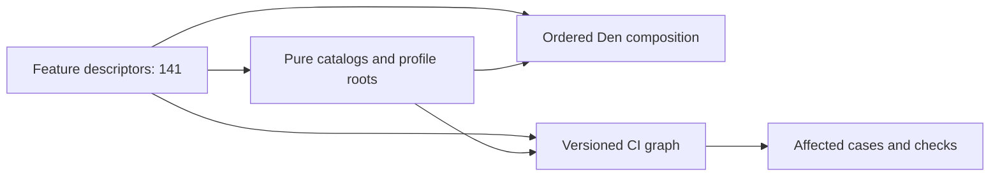

<!-- Generated by write-ci-graph. -->
# Foundation module graph

Discovered applications: 60; roles: 10; capabilities: 31.
Discovery registers features. Profile roots activate them. Home evaluation checks actual Den membership against the graph.
