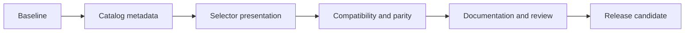

# Home Manager profile refactor implementation plan

Status: classification, Den/gen and normalization slices implemented and
validated, together with F1a reader readiness. Personal application proposals are
recorded in [PERSONAL-PROFILES](../PERSONAL-PROFILES.md).
User decision: **classify first, split applications later**. Firmware has been
updated manually and is outside this plan's critical path.

Architecture: [ARCH-profile-refactor](../architecture/ARCH-profile-refactor.md).
Evidence and original Den research: [review](../PROFILE-ARCHITECTURE.md).
Prepared using the great-cto staged refactor workflow, with a read-only architect
review. Execute code tasks sequentially, with one active writer and ownership
transferred only after the preceding task closes.

## First release: professional classification

Success means Developer, Sales, Trainer, Support, Executive and IT are visibly
classified as Professional, Personal is registered as a peer for future work,
and selecting the same roles/packages produces the same application set.

Keep profile schema 2, catalog schema 3, compatibility 1, current Den/gen pins,
role IDs/order, hardware selectors, Home Manager state version, output names,
and `mkHomeConfiguration` unchanged. Do not migrate existing profiles, move
applications, or add a category toggle with no behavior.

### Sequential task and ownership matrix

| Task | Owned files | Work and completion condition |
| --- | --- | --- |
| P0 Baseline | Temporary comparison artifacts only | Record the actual starting diff, including existing Herdr/Zsh/XDG changes. Capture catalog/profile and the complete P3 composition matrix from that working tree before P1. Run current fixtures; attribute existing failures before editing. |
| P1 Catalog | `lib/catalog.nix`, `lib/home-catalog.nix` | Add ordered category registry and role classification. Export additive grouped metadata derived from roles. Preserve old custom-domain support and all old projected fields. |
| P2 Selector | `lib/applications.nix`, `modules/finite.nix`, `modules/finite-configure` | Supply the generated catalog to the selector, derive ordered role/package rows, show Professional classification, preserve IDs/current choices/cancellation and one apply call. Preserve existing edits in the packaging module. |
| P3 Verification | New focused catalog/selector fixture files; `tests/check.sh`; `tests/nix-check.sh` only if needed to run the parity matrix | Cover the acceptance matrix below. Integrate checks into existing test entry points; do not add a second CI framework. |
| P4 Documentation | Existing README/CHANGELOG and this refactor's planning docs; retained refactor-only patch artifact | Describe current Professional grouping, future Personal behavior, and unchanged profile/application semantics. Preserve existing changelog entries. Record commands/results and anything not run. Retain a patch from P0's actual baseline to P4, including fixtures/docs, that excludes unrelated existing edits. |

Task dependencies:



Text fallback: `P0 -> P1 -> P2 -> P3 -> P4 -> release candidate`.
First-slice planning estimate: roughly one focused engineering day plus CI/build
time and review; this is an estimate, not a measured delivery promise. Use one
implementation agent. Read-only specialist reviews can follow completed writes.
Do not run later refactor tasks concurrently against the same catalog/modules.

### Exact first-slice contract

- Domain registry order: Professional 10, Personal 20; role order remains
  Developer 10, Sales 20, Trainer 30, Support 40, Executive 50, IT 60.
- Each existing role has `classification = "professional"`. Home catalog adds
  `classifications` keyed by category name, with `name`, `label`, `order`, and
  derived `roles`; it also adds `roles.<id>.classification`.
- Existing `.foundations.<id>.profiles` retains Finite image mappings. No
  `profiles`/classification selection is persisted in schema-2 profile JSON.
- Export the packaged home-catalog file as `applications.profileCatalog` and
  pass it to the selector through `FINITE_FOUNDATION_CATALOG`. Role/package
  rows come from that one catalog and keep hidden IDs unchanged.
- Existing custom `mkHomeCatalog` inputs lacking categories remain valid:
  empty registry, null classification on unclassified roles. Reject explicit
  references to nonexistent categories. Personal has no implicit roles/apps.
- No changes to `homeCompatible`, aspect namespaces, package providers, update
  backends, hardware configuration, or optional-package selection semantics.

### Acceptance matrix

| Area | Required cases and assertions |
| --- | --- |
| Catalog | Exactly six Professional roles in existing order; Personal has no roles; classifications resolve; old fields match the baseline after removing additive metadata. |
| Custom catalog | Old domain without category fields still evaluates; a custom role stays unclassified unless declared; invalid explicit category reference fails clearly. |
| Selector | Correct checked state and order, Professional shown, hidden role/package IDs unchanged, no Personal checkbox; cancel either dialog calls no apply command; accept calls apply exactly once with both selections. |
| Schema/API | Existing profile generator still emits schema 2; same selections produce the same data; constructor/output/aspect names remain available; no profile/lock/local-module rewrite merely from viewing the selector. |
| Composition | Both Bluefin variants × both current hardware IDs × eight selections: no roles/packages, all six roles/all optional packages, and each single role/no optional packages. Capture all 32 cases at P0; compare packages, Flatpaks, user units, relevant environment, identity and state version at P3. |
| Finite | Generate its catalog with the new Foundation source in a temporary evaluation fixture. Preserve `finite`/`finite-dev` image mappings and show additive metadata survives. No image build or activation is required for the catalog-only assertion. |
| Workspace | Herdr's unstable pin, Zsh behavior, XDG paths and existing migration fixtures remain present. Lock files do not change as a side effect of evaluation. |

For package parity, only the five Foundation command packages
`finite-configure`, `finite-home-apply`, `finite-home-update`,
`finite-home-migrate`, and `finite-app-status` may differ in store path because
they embed the changed source. Compare their names/versions and multiplicity;
require exact output-path equality for all other application packages. Keep
changes to command behavior covered by selector and existing updater fixtures.
Do not normalize all `/nix/store` paths, which could hide provider changes.

First run targeted catalog/selector checks while developing. At P3 run:

```bash
bash tests/check.sh
bash tests/nix-check.sh --no-build
nix develop --no-update-lock-file path:.#ci --command bash tests/ci.sh
```

Run `bash tests/nix-check.sh` for the release candidate on a sufficiently
resourced builder. No test activates a home. If network/cache or build resources
prevent a check, report it as not run or inconclusive; do not substitute source
inspection for a passing evaluation/build.

Rollback reverses the retained P0-to-P4 refactor-only patch, including its
catalog/selector changes and associated fixtures/docs, then rebuilds the previous
release. It must preserve the pre-existing Herdr, Zsh, XDG, README and CHANGELOG
edits. A plain `git diff HEAD` patch is insufficient when it combines those
changes with this refactor; derive the patch against the captured P0 working
tree. No profile conversion or data migration needs undoing. If a later explicit
activation occurred, use the prior Home Manager generation; reverting source
does not automatically change the host.

## Subsequent implementation stages

These remain separate reviewable changes. Each stage has a concrete exit
condition; application placement is intentionally deferred, not silently decided
by the earlier research document.

| Stage | Dependencies and implementation | Exit condition |
| --- | --- | --- |
| D1 Den/gen baseline | After P4, target only Den and its reviewed CI-tested gen closure. Inspect lock changes; preserve unrelated pins and the Herdr input. | Existing schema-2 role/hardware matrix and explicit include/dedup behavior evaluate with the new pins. No package reorganization. |
| N1 Validation bridge | Before any new writer: implement pure Nix structural normalization and resolve it/catalog data from the staged, locked Foundation revision. Keep account/image checks in Python. Remove unconditional schema downgrading in initialization; retain schema-2 writers. | Old helper/source, bridge helper/source and candidate target combinations are tested; valid order normalizes consistently, unknowns/duplicates fail; staging cannot use a stale caller catalog. |
| F1a Reader readiness | Coordinate current schema-1/2 first-login, seed/cloud-init, CLI and typed catalog projection; add explicit capability checks across running helper, selected Foundation, and provisioning code. | Fresh-login, seeded and existing-consumer fixtures preserve supplied data, reject unsupported input without replacement, and retain schema-2 writers. |
| A1 Application contract | After F1a: use the confirmed lightweight Personal direction and proposed Family/Media/Creative/Gaming roles; finalize per-app ownership, schema-3 selection/migration interface and preview additions/removals. Existing work-role selection implies Professional without its sibling roles. | The format and app membership contracts are defined; schema 2 retains its legacy declaration set; every current app is accounted for, including Chromium/camera controls. |
| F1b Future-format readers | After A1 defines the exact format: implement and test dual readers across Foundation helpers and Finite first-login/provisioning. Advertise only support implemented by the executing code. | Old/new inputs are accepted by the reader bridge while default writers remain schema 2; incompatible helper/source combinations fail before writing. |
| A2 Writers and migration | After A1/F1b: implement selector/CLI migration and enable schema-3 writing only with verified reader/helper support. Keep source and profile rollback separate. | Both categories compose; update/build/activation and recovery fixtures pass for old and migrated consumers; unmanaged Flatpaks stay preserved; no silent schema rewrite. |
| H1 Host composition | After D1 and the normalization bridge: add form-factor, CPU, integrated/discrete GPU and model selections; retain legacy hardware IDs/env/module adapters. Serialize shared-file edits with A1/A2. | Laptop/desktop and Intel/AMD/mixed-GPU evaluation passes; Dell panel/camera behavior preserved; no desktop-only home receives laptop power units; no Bluefin-owned drivers/PAM/services are installed by Home Manager. |
| U1 Update hardening | Independent Finite task: retain OS → Flatpak → Brew → Foundation; move root rejection before upstream execution; establish a supported failure-propagation integration. Do not parse upstream recipe bodies as an assumed stable API. | Failure-injection fixtures prove each failed prerequisite prevents Foundation activation, intentional Brew skips work, and the staged updater's backup/resource/recovery behavior remains. |

Text dependency map: `P4 -> D1`; `P4 -> N1 -> F1a -> A1 -> F1b -> A2`;
`D1 + N1 -> H1`; `U1` is independent. Implementation is still sequential where
files overlap. Do not bundle U1 or new power policies into the classification PR.

Plan the later schema-3/catalog-4 exact interface only at A1, after current reader
readiness is proven. Actual future-format readers follow that contract at F1b,
before A2 enables new writers. This splits the previous F1 requirement so that
readers are not implemented before their data format is defined.
The earlier JSON example is a candidate, not an instruction
to change public data in P1. No arbitrary support lifetime or release
compatibility bump is established by this document.

N1 is implemented: `lib.normalizeProfile` owns schema-2 structure/order, and
staging resolves that API plus `homeCatalog` from the selected locked revision.
Only API absence enables the legacy schema-2 validator; target errors propagate.
Account/image checks remain in Python. Canonical profile writes replace staged
entries atomically, preserving live symlink targets on failure. Initialization
converts schema 1 explicitly and rejects unsupported schemas. See the
[N1 validation report](../qa-reports/QA-validation-bridge.md) for compatibility
scope and parity evidence. F1a coordinates existing readers and capability checks;
A1/F1b precede Personal application and writer enablement at A2.

F1a is implemented and validated across the running helper, staged source and
Finite adapters. See the [reader readiness report](../qa-reports/QA-finite-reader-readiness.md).
Finite changes are isolated in jj change `pvuoruok`, workspace
`/tmp/finite-profile-readers`; its existing Foundation pin is unchanged. A1 is
the next contract stage; F1b must precede any new-format writer at A2.

## Risks, deferred choices, and handoff

- **Catalog consumers:** additive fields still need a compatibility test;
  Finite's typed role projection currently drops unknown fields. Extend its
  options/projection together when consuming classification there.
- **False parity failures:** new selector store paths can change the activation
  derivation. Compare declared composition and selected behaviors, not a demand
  for identical whole derivation hashes.
- **Legacy app removal:** Personal and Professional are not yet a complete
  partition. A1 must explicitly decide each moved app, not infer intent from names.
- **New profile recovery:** dual readers must ship before writers; test old
  controller catalogs and manually locked consumers, not just the newest checkout.
- **Hardware scope:** preserve existing native lid/power behavior initially.
  AC plus external-input-only lid handling needs a separate, user-confirmed
  docking predicate and physical tests. Firmware has already been updated;
  do not restore firmware work as a prerequisite.

Resolved product decisions: all six work roles are Professional; classify before
splitting applications; preserve current application sets; firmware maintenance
is already handled. No user answer is outstanding for P0–P4. Later A1 app
membership and any custom docking behavior require their own concrete proposal.

The user requested implementation after reviewing this architecture/plan.
Before release, require code review plus compatibility/parity evidence and
record the release action separately. Implementation does not publish, deploy,
or activate a workstation configuration.

## Planning validation

Current `bash tests/check.sh` passed, including the 23 Python consumer/update
tests and existing Brew, Dell-panel and role/aspect fixtures. A direct Nix
evaluation confirmed the six current role IDs/order and the separate
`homeCompatibleRoleNames` values. Planning document links/fences/whitespace passed.
These planning checks validated the pre-implementation baseline. The subsequent
implementation has focused catalog/selector tests, a full before/after matrix,
and repository checks documented in the
[implementation validation report](../qa-reports/QA-profile-classification.md).
The next dependency slice passed full checks and composition parity; see the
[Den/gen upgrade report](../qa-reports/QA-den-baseline.md).
